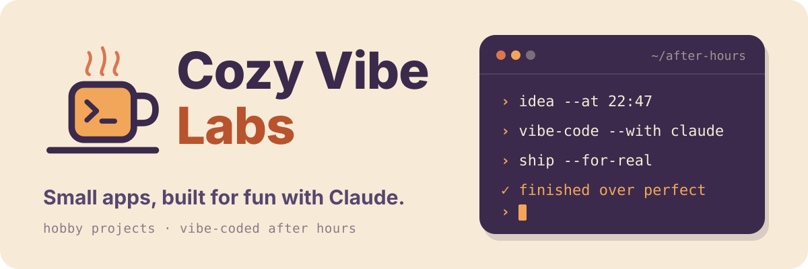

  

Apps we make because we want them to exist, not because a roadmap says so. Everything here is a hobby project, built with AI-assisted development and shipped for real.

## How we work

- Built after hours, mostly with Claude.
- Small scope, finished over perfect.
- Self-hosted and privacy-friendly where it makes sense.

## Say hi

Issues and pull requests are welcome in each project's repository. These are hobby projects, so replies may take a few days.
